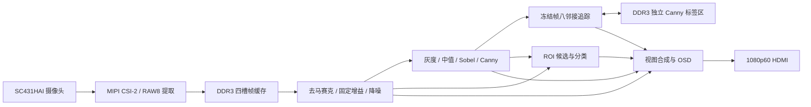

# V4-ddr1 技术文档

本工程在易灵思 Titanium Ti60F225I3 上实现从相机输入到 HDMI 输出的实时图像处理。FPGA 完成采集、帧缓存、边缘提取、识别和画面合成。主机用于构建与烧录。

## 硬件与数据通路

| 部分 | 本版配置 | 工程入口 |
| --- | --- | --- |
| FPGA | Ti60F225，I3 时序模型 | [项目文件](../ti60f225_oob.xml) · [RTL 顶层](../rtl/ti60f225_oob_top.v) |
| 相机 | SC431HAI，I²C 配置，MIPI CSI-2 采集 1920×1080 RAW10 | [相机控制](../rtl/cam_i2c_ctrl) · [CSI-2 IP](../ip/csi_rx_controller) |
| 帧缓存 | 板载 x16 DDR3，Efinity DDR3 Soft Controller 5.16 | [DDR3 配置](../ip/ddr3_official/settings.json) · [AXI 适配](../rtl/frame_buffer_V3/efinity_ddr3_adapter.v) |
| 显示 | HDMI 1920×1080 @ 60 Hz，双像素处理时钟 74.25 MHz | [视频合成](../rtl/edge/video_compositor.v) · [HDMI 编码](../rtl/dvi_tx) |
| 板级接口 | 相机、DDR3、HDMI 与三个低有效按键 | [引脚约束](../ti60f225_oob.peri.xml) · [时序约束](../ti60f225_oob.sdc) |



CSI-2 接收端取 RAW10 的高 8 位写入帧缓存。显示侧读取 RAW8 并完成 Bayer 去马赛克、固定 RGB 增益与降噪，供边缘、识别及彩色显示使用。相机输入、存储与视频时钟之间通过 FIFO 和配置握手传输。HDMI 的 60 Hz 是显示刷新率，OSD 的 FPS 取自显示侧帧同步。

## DDR3 帧缓存与冻结

Efinity 2026.1.132 生成 DDR3 Soft Controller 5.16。板级 DDR3 时钟为 400 MHz，主控制器时钟为 200 MHz，应用侧 AXI 为 128 位、100 MHz。DDR 校准完成且通过后释放帧缓存复位。[DDR 适配器](../rtl/frame_buffer_V3/efinity_ddr3_adapter.v)保持受背压的地址仲裁选择，并保存写事务 ID。

| DDR 地址 | 用途 | 数据量 |
| --- | --- | --- |
| `0x00000000`、`0x00400000`、`0x00800000`、`0x00C00000` | 四个 RAW8 帧槽，每槽 4 MiB | 每帧 2,073,600 字节 |
| `0x01000000` 起 | 冻结 Canny 标签与追踪状态 | 4 bit/像素，合计 1,036,800 字节 |

采集端检查帧长度，写入端收到成功响应后才发布可读槽位。当前读取的帧与冻结选择的帧受到覆盖保护。冻结期间暂停接收新帧，已经接收的完整帧可完成写入并发布。按键选择按有效缓存帧的新旧顺序移动，到达最旧或最新一项时保持当前帧。帧号与可读槽位由[历史帧管理模块](../rtl/frame_buffer_V3/ddr_history_manager.v)维护。

## 边缘流水与显示

[双像素流水](../rtl/edge/contest_pipeline_2px.v)每拍处理两个像素。灰度采用定点公式 `(77R + 150G + 29B) >> 8`，3×3 中值由固定比较交换网络求得，Sobel 幅值取 `|Gx| + |Gy|`。帧边界更新算法和阈值，保持同帧参数一致。

- **BASIC** 对共享预处理后的灰度图执行 Sobel。**MED SOBEL** 在 Sobel 前加入 3×3 中值。
- **CANNY** 使用中值、梯度方向、非极大值抑制和双阈值。低阈值取高阈值的一半。实时画面通过局部邻域连接弱边和强边。
- **冻结 Canny** 把所选帧的标签写入独立 DDR 区域，从强边出发沿八邻域递归追踪弱边。处理依次经过 `CAPTURE`、`TRACE` 和 `FLUSH`，到达 `EXACT:READY` 后显示与源帧及阈值匹配的结果。[冻结帧控制](../rtl/edge/canny_recursive_frame.v) · [八邻接追踪](../rtl/edge/canny_hysteresis_exact.v)
- **视图合成** 对齐 RGB、灰度与边缘，提供灰度／白边分屏、全屏 RGB 红边叠加与 RGB 三种视图。OSD 显示模式、阈值、缓存状态和识别结果。

自动阈值关闭。边缘阈值与 DIGITS 灰度阈值分别保存，均从 128 开始，可按 8 为步长调节至 32～192。RGB 增益系数固定为 R280 / G240 / B376。

## 目标识别

| 功能 | 输入与区域 | 分类方法 |
| --- | --- | --- |
| 几何图形 | 中央 960×540 区域的边缘图 | 以连通域、包围框和轮廓几何特征区分圆、矩形与三角形 |
| 印刷数字 | 中央 960×540 区域，按手动灰度阈值提取前景 | 对单个候选归一化并用定点特征匹配识别 0～9 |
| 中文单手数字 | 中央 960×1080 区域的手形掩膜与同帧灰度 | 候选筛选后进行双通道 INT8 CNN 推理，输出背景或数字 1～10 |

[识别调度与连通域](../rtl/edge/shape_engine_2px.v)使用 8×8 像素网格与双缓冲，采集完整帧后处理候选。74.25 MHz 域中的采样间隔为 37,125,000 个时钟，对应 0.5 秒。

HANDS 使用固定 YCbCr 条件与邻域支持净化掩膜。[CNN 输入模块](../rtl/edge/hand_cnn_match.v)把手形掩膜与手内灰度采样为 2×32×32。[推理核心](../rtl/edge/hand_cnn_core.v)使用三层卷积，输出通道数依次为 16、24、32，随后全连接输出 11 类。非背景类别在最高与次高分差至少为 64 个 Q6 单位时进入确认，两个不同有效源帧同类才发布结果。网络参数保存在[模型 ROM](../rtl/edge/cnn)和[模型配置](../config/model.json)中。

## 上板操作

项目成员已在 V4-ddr1 上完成以下功能的板上验证。

| 功能 | 板上操作与观察 |
| --- | --- |
| 图像与边缘显示 | 在 BASIC、MED SOBEL、CANNY 之间切换，观察灰度、边缘及红边叠加 |
| 阈值调节 | 在边缘模式或 DIGITS 中按 KEY0／KEY1，观察 OSD 阈值变化 |
| 历史帧切换 | KEY2 长按冻结，按住 KEY2 分别配合 KEY0／KEY1，观察画面与 `ID`、`AGE` 同步切换 |
| 冻结 Canny | 在 CANNY 模式冻结，等待 `EXACT:READY` 后观察选定帧的递归边缘 |
| 几何与印刷数字 | 将单个图形或印刷数字放在中央识别区域，观察分类显示 |
| 中文单手数字 | 在 HANDS 中将单手放入中央区域，保持手势至确认，观察右侧掩膜和屏显结果 |

完整模式顺序及按键表见[首页操作说明](../README.md#板上操作)。

## 构建与部署

Windows 构建环境使用 Efinity 2026.1.132 与 Python 3。复现构建时从新检出的工程目录运行，预留 `H:` 和 `V:` 供脚本映射工程与工具路径。默认工具目录为 `E:\Efinity 2026`，默认 Python 为 `C:\Python314\python.exe`，可通过命令参数指定实际安装位置。

```powershell
powershell -ExecutionPolicy Bypass -File .\build.ps1 -EfinityHome 'E:\Efinity 2026' -Python 'C:\Python314\python.exe'
```

[构建脚本](../build.ps1)依次完成 `map`、`interface`、`pnr`、`pgm`，并在 `.build` 下保存阶段日志、BIT、HEX 与输入 SHA256 清单。2026 年 11 月 4 日封存的 V4-ddr1 四阶段均通过，结果见[固件清单](../firmware/manifest.json)。

| 构建指标 | V4-ddr1 |
| --- | ---: |
| LUT4 | 29,730 |
| FF | 17,795 |
| RAM10 / DPRAM10 | 240 / 6 |
| DSP48 / DSP24 | 54 / 3 |
| 最差 setup 裕量 | +0.341 ns |
| 最差 hold 裕量 | +0.026 ns |

部署仓库内已封存的镜像时，连接开发板 JTAG 并在工程根目录执行以下命令。

```powershell
powershell -ExecutionPolicy Bypass -File .\flash.ps1 -EfinityHome 'E:\Efinity 2026' -Python 'C:\Python314\python.exe'
```

[烧录脚本](../flash.ps1)依据清单核对构建输入及 BIT／HEX，从 Flash 地址 0 读取并保存覆盖前备份，写入 HEX 并执行厂商内置写后检查，再通过 JTAG 加载应用 BIT。2026 年 11 月 4 日的部署记录显示写入载荷为 981,919 字节，覆盖前备份为 1,048,576 字节，厂商检查通过。固件源标签 `V4-ddr1` 指向 `30e188eae609d9e6c22cf66266fbef7e95a1490c`。[BIT 与 HEX](../firmware) · [交付文件 SHA256](../FILELIST.sha256)
